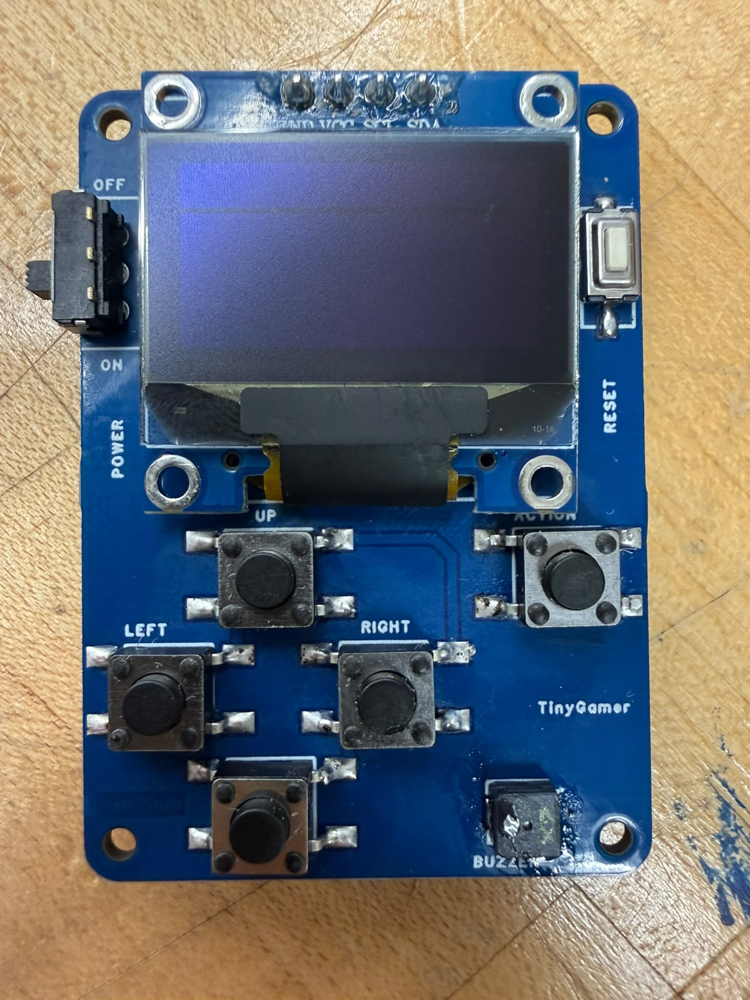

# Tiny Gamer

## Project Owner

**Name:** Krish Shah  
**Virginia Tech Email:** krish0728@vt.edu

## Project Overview

Tiny Gamer is a completed compact handheld gaming device built around the ATtiny85 microcontroller. The project combines a custom PCB, a 128x64 OLED display, physical controls, and battery power into a small standalone gaming platform.

The final system runs a Space Invaders-style game on the ATtiny85. The player uses four directional buttons and one action button, with separate power and reset controls. The device is powered by a CR2032 coin cell and was programmed using the Arduino development environment.

This project demonstrates how a complete interactive game can be implemented on a resource-constrained 8-bit microcontroller with limited flash, RAM, GPIO, and processing power.

## What I Learned

Through this project, I gained hands-on experience with:

- ATtiny85 embedded programming
- OLED graphics and game-loop development
- Programming within tight flash and RAM limits
- PCB design in EasyEDA
- PCB assembly and hardware bring-up
- Reading multiple buttons with limited microcontroller I/O
- Hardware/software integration
- Debugging display orientation, input handling, and game performance
- Optimizing OLED updates to reduce gameplay lag
- Programming an SOIC-8 ATtiny85 using an external programmer/test clip

## Design and Implementation

### Hardware

- ATtiny85-20SU microcontroller
- 128x64 OLED display
- Custom PCB designed in EasyEDA
- 4 directional buttons: Up, Down, Left, Right
- 1 action/fire button
- 1 power slide switch
- 1 reset button
- CR2032 coin cell battery and holder
- On-board buzzer footprint
- Supporting resistors and capacitors

### Software

The firmware was developed in the Arduino environment for the ATtiny85 running from its internal 8 MHz clock.

The final game is a Space Invaders-style game with:

- Player movement
- Action/fire control
- Enemy formation
- Player and enemy projectiles
- Score tracking
- Player lives
- Win and loss states
- OLED HUD

Because the ATtiny85 has limited memory and processing resources, the game code and display updates were kept lightweight. OLED redraw behavior was optimized to make gameplay smoother and reduce visible lag.

### Input Design

The four directional buttons are read through a resistor ladder using a single analog input, helping conserve the ATtiny85's limited GPIO pins. The action button uses a separate digital input.

### PCB

The custom PCB was designed in EasyEDA and manufactured from the Gerber files included in this repository. The completed board integrates the ATtiny85, OLED interface, controls, battery holder, reset circuit, power switch, and supporting components.

### Final Status

**Project Status: Complete**

The PCB was manufactured and assembled, the ATtiny85 was successfully programmed, the OLED and all five gameplay buttons were tested, and the Space Invaders game runs on the completed hardware.

## Bill of Materials

| ID | Item | Designator | Qty | Package | Manufacturer Part | Unit Cost | Total Cost | Link |
|---:|---|---|---:|---|---|---:|---:|---|
| 1 | Buzzer | BUZZER1 | 1 | BUZZER-4.0X4.0-2P-SMD | SMT-0440-T-HT-R | $3.21 | $3.21 | [DigiKey](https://www.digikey.com/en/products/detail/pui-audio-inc/SMT-0440-T-HT-R/13165922) |
| 2 | 2k | R7, R9 | 2 | 0603 | RC0603FR-072KL | $0.11 | $0.22 | [DigiKey](https://www.digikey.com/en/products/detail/yageo/RC0603FR-072KL/727009) |
| 3 | 20k | R6 | 1 | 0603 | RC0603FR-0720KL | $0.10 | $0.10 | [DigiKey](https://www.digikey.com/en/products/detail/yageo/RC0603FR-0720KL/727040) |
| 4 | 4.7k | R3, R2 | 2 | 0603 | RC0603FR-074K7L | $0.10 | $0.20 | [DigiKey](https://www.digikey.com/en/products/detail/yageo/RC0603FR-074K7L/727212) |
| 5 | 10k | R1, R8 | 2 | 0603 | RC0201FR-0710KL | $0.10 | $0.20 | [DigiKey](https://www.digikey.com/en/products/detail/yageo/RC0201FR-0710KL/1948870) |
| 6 | 3.9k | R5 | 1 | 0603 | RC0603FR-073K9L | $0.11 | $0.11 | [DigiKey](https://www.digikey.com/en/products/detail/yageo/RC0603FR-073K9L/727136) |
| 7 | 8.2k | R4 | 1 | 0603 | RC0201FR-078K2L | $0.10 | $0.10 | [DigiKey](https://www.digikey.com/en/products/detail/yageo/RC0201FR-078K2L/3202425) |
| 8 | Battery Holder | B1 | 1 | BATTERY-3 | BHSD-2032-SM | $1.68 | $1.68 | [DigiKey](https://www.digikey.com/en/products/detail/mpd-memory-protection-devices-/BHSD-2032-SM/2647817) |
| 9 | OLED | OLED | 1 | OLED | OLED | $1.00 | $1.00 | [AliExpress](https://www.aliexpress.us/item/3256811978952578.html) |
| 10 | Tactile Switch | ACTION, UP, DOWN, RIGHT, LEFT | 5 | 6.00mm x 6.00mm | TS04-66-50-BK-260-SMT | $0.20 | $1.00 | [DigiKey](https://www.digikey.com/en/products/detail/same-sky-formerly-cui-devices-/TS04-66-50-BK-260-SMT/15634371) |
| 11 | ATtiny85-20SU | U1 | 1 | SOIC-8_208MIL | ATTINY85-20SU | $1.50 | $1.50 | [DigiKey](https://www.digikey.com/en/products/detail/microchip-technology/ATTINY85-20SU/735470) |
| 12 | Slide Switch | POWER | 1 | SLIDE SWITCH | EG1270 | $1.09 | $1.09 | [DigiKey](https://www.digikey.com/en/products/detail/e-switch/EG1270/6076) |
| 13 | Reset Switch | RESET | 1 | KEY-3.0*6.0 | PTS636SM25FSMTR LFS | $0.28 | $0.28 | [DigiKey](https://www.digikey.com/en/products/detail/c-k/PTS636SM25FSMTR-LFS/10071742) |
| 14 | 100nF Capacitor | C1 | 1 | 0603 | CL10E104KC8VPNC | $0.32 | $0.32 | [DigiKey](https://www.digikey.com/en/products/detail/samsung-electro-mechanics/CL10E104KC8VPNC/20498486) |
| 15 | 47uF Capacitor | C2 | 1 | 1206 | CL31A476MPHNNNE | $0.63 | $0.63 | [DigiKey](https://www.digikey.com/en/products/detail/samsung-electro-mechanics/CL31A476MPHNNNE/3888721) |
| 16 | Battery | — | 1 | - | CR2032 | $0.39 | $0.39 | [DigiKey](https://www.digikey.com/en/products/detail/panasonic-energy/CR2032/31939) |
| 17 | SOIC 8-Pin Test Clip | — | 1 | - | 5315 | $14.95 | $14.95 | [Adafruit](https://www.adafruit.com/product/5315) |

**Estimated Total Cost:** $26.98

## Timeline and Milestones

| Milestone | Target Date | Status |
|---|---|---|
| Project planning | October 2026 | Complete |
| PCB design in EasyEDA | October 2026 | Complete |
| PCB manufacturing | October 2026 | Complete |
| PCB assembly and hardware bring-up | October 2026 | Complete |
| OLED and button testing | October 2026 | Complete |
| Game development | October 2026 | Complete |
| Performance optimization and debugging | October 2026 | Complete |
| Final testing | October 2026 | Complete |
| Project completion | October 2026 | Complete |

## Progress Log

### 2026-10-05

- Defined the Tiny Gamer project concept.
- Selected the ATtiny85 as the main microcontroller.
- Selected an OLED display for the user interface.
- Designed the custom PCB in EasyEDA.
- Prepared the PCB for manufacturing.

### 2026-10-22

- Successfully programmed the ATtiny85.
- Verified the OLED display and gameplay buttons.
- Ran Space Invaders on the Tiny Gamer hardware.
- Identified gameplay lag and optimized display/game updates for smoother operation.

### 2026-10-29

- Completed final hardware and software testing.
- Confirmed the Tiny Gamer project is complete.
- Updated project documentation and repository.

## Project Files

The repository currently includes:

- [Gerber PCB manufacturing files](Gerber_PCB_TinyGamer.zip)
- [Project cover image / PCB render](hero.png)
- Project documentation in this README

Additional source or design files can be added to the repository as needed.

## Useful Links

- [ATtiny85-20SU - DigiKey](https://www.digikey.com/en/products/detail/microchip-technology/ATTINY85-20SU/735470)
- [SOIC 8-Pin Test Clip - Adafruit](https://www.adafruit.com/product/5315)
- [EasyEDA](https://easyeda.com/)

## Project Image

The final Tiny Gamer PCB render is stored as `hero.png` in the root of this repository and is used as the project cover image on the AMP Lab website.
